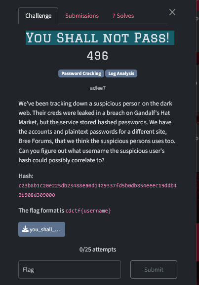
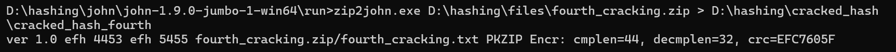
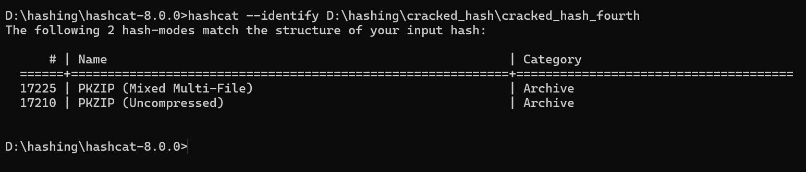
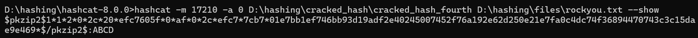
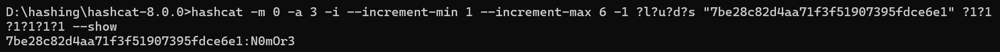

# Cryptographic Hashing & Debugger Analysis Lab Log

This collection acts as a standalone technical journal recording practical investigation into Windows assembly debugging instruments and the syntax used for offline password cracking.

Progress: Successfully initialized an offline cracking lab environment.

Actions: Verified hardware configuration utilizing an AMD GPU via OpenCL at 29,000 kH/s. Cracked a custom MD5 fingerprint against the `rockyou.txt` database.

Takeaways: Evaluated combinatoric keyspace limits. Identified the requirement rules for identifying hash formats ('-m') and tracking boundary characters prior to executing brute-force operations.

---

## Featured CTF Upsolves
### CDCTF 2026 — You Shall Not Pass! (Password Cracking)

Category: Password Cracking & Log Analysis

Type: Post-Competition Practice Lab (Upsolve)

Tools Used: Hashcat v8.0.0 & Windows Command Prompt

### Challenge Overview ###

Given a 64-character target hash (`c23b8b1c20e225db23488ea0d1429337fd5b0db854eeec19ddb42b908d309000`) and two leaked data files (`passwords.txt` and `usernames.txt`), the goal was to find the correct password and tie the password to the username.

### Attachments


.png)
* [Password_Lists](./attachments/cdctf-2026/passwords.txt)

* [User_Lists](./attachments/cdctf-2026/users.txt)

### Methodology
1. **Hash Identify:** Used `hashcat --identify` to confirm the hash structure matched **SHA-256 (`-m 1400`)**.
2. **Strategy:** Attempted a mask brute-force attack (`-a 3`), but realized a 13-character mixed-case password with symbols (`Este4#Healing`) as the targeted password is too large for raw brute force. So change to straight dictionary attack (`-a 0`) using the provided breach passwordlists.
3. **Cracking & Analysis:**
   ```cmd
   hashcat -m 1400 -a 0 hash_you_shall_not_pass.txt passwords.txt --force
   ```
   * Recovered plaintext password: `Este4#Healing` (Line 240 in `passwords.txt`).
   * Matched Line 240 in `usernames.txt` to identify the user: `CirdanTheShipwright`.
### Flag
The flag is the username value of line 240
```
cdctf{CirdanTheShipwright}
```
### Key Takeaway
Always analyze the context and provided wordlists before running brute-force attacks. Targeted dictionary attacks (`-a 0`) solve complex passwords in milliseconds when leak data is available.

### References & Credits
* Challenge solution approach studied from [dungpmuit's CDCTF-2026 Writeup] [dungpmuit's CDCTF-2026 Writeup](https://github.com/dungpmuit/WriteupCTF/tree/main/CDCTF-2026/HAT/You%20Shall%20not%20Pass!).

---

## `.zip` extraction lab
* **Objective:** Retrieve encrypted metadata from a password-secured `. zip` file, access the main document, and restore a lost inner password hash.
* **Tools:** `zip2john.exe` (John the Ripper Jumbo), `Hashcat v8.0.0`

## Attachments
* **Extracted Archive**


* **Identify the zip**


* **The zip password**


* **The hash**



### Execution & Troubleshooting
1. **Hash Extraction:** Used `zip2john.exe` to extract the archive metadata into a text file (`fourth_cracking.zip > cracked_hash_fourth.txt`) and cleaned the filename prefix so the string started cleanly with `$pkzip2$`. Using the code below to extract the archive
```
zip2john.exe D:\hashing\files\fourth_cracking.zip > D:\hashing\cracked_hash\cracked_hash_fourth
```
2. **Identify:** By running `hashcat --identify` to pinpoint the exact PKZIP variant (`-m 17210`) and cracked the outer archive password, revealing the password of the zip file.
3. **Hash Recovery:** Extracted the hash file from the unzipped folder. After a quick dictionary + `best66.rule` check exhausted, move to an incremental custom mask attack:
```cmd
hashcat -m 17210 -a 3 -i --increment-min 1 --increment-max 6 -1 ?l?u?d?s "7be28c82d4aa71f3f51907395fdce6e1" ?1?1?1?1?1?1 --force
```
* **Key Takeaway:** Consistently check the specific archive compression types using `--identify` prior to attempting to extract.

